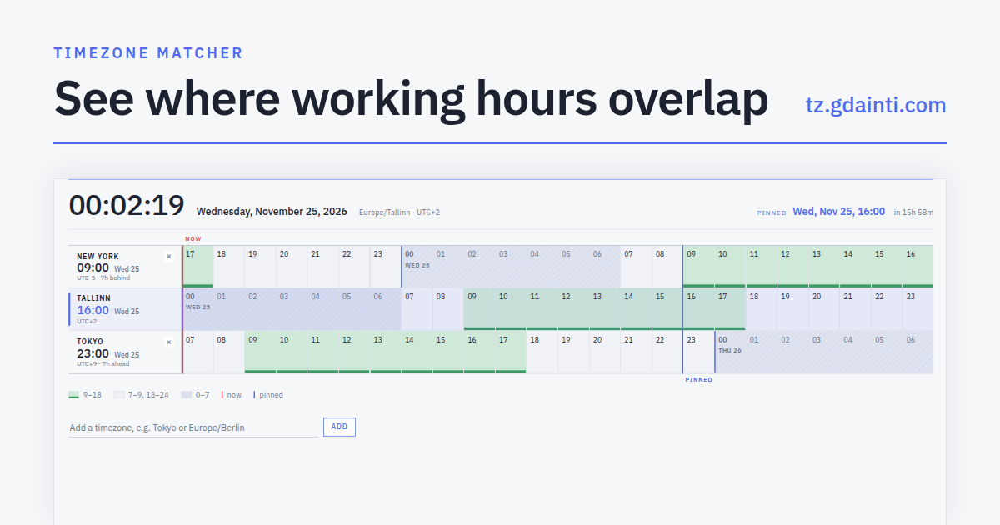

# Timezone Matcher

**[tz.gdainti.com](https://tz.gdainti.com)** · free, no sign-up



See several time zones as rows on one shared 24-hour timeline, so you can tell at a glance where
working hours overlap and pick a meeting time that suits everyone.

- Your own time zone is detected; add any city or IANA zone (`Tokyo`, `Europe/Berlin`, `UTC`).
- Hover the timeline to read the same instant in every zone; click to pin it and see how far away it is.
- Working hours, early and late hours, and night are shaded per zone; daylight saving is handled.
- **Share** copies a link to your zones and pinned time. Whoever opens it sees your setup, and their
  own saved zones stay untouched until they choose to keep yours.
- Pick a date in a calendar that starts the week the way your country does.
- Installable as an app and works offline. Choices are saved in your browser; nothing is sent anywhere
  except Google Analytics page views.

Built with Svelte 5, TypeScript and Vite. No backend.

## Development

```sh
npm install
npm run dev      # http://localhost:5173
npm run check    # svelte-check and TypeScript
npm run build    # into dist/
```

`scripts/og/render.sh` re-renders the social preview image (`public/og-image.png`) from the built app,
and `scripts/gen-zone-country.mjs` regenerates the time zone → country table used for the week start.

## Deployment

One Docker container serves the built site with nginx; there is no backend. Shipping works the same
way as slicefall.

Pushing to `main` runs `.github/workflows/deploy.yml`:

1. **check**: `npm run check`. This also runs on pull requests.
2. **image**: builds the Docker image and pushes `ghcr.io/gdainti/timezone-matcher:latest` and
   `:sha-<commit>`. Pull requests only build it.
3. **deploy**: calls the deployment webhook. The server runs
   `/opt/docker/timezone-matcher/deploy.sh`, which pulls the image, restarts the container and
   waits until it is healthy. Without `WEBHOOK_URL` set, this step only warns.

The image is unprivileged nginx (uid 101) on port 8080 with the site in `/srv/www`, owned by root
and read-only to nginx. `nginx/default.conf` serves gzip-precompressed files, caches `/assets/`
(hashed names) for a year and revalidates everything else, answers `/healthz`, allows only GET and
HEAD, and sends the security headers in `nginx/security-headers.conf`: a strict CSP (no inline
scripts or styles; Google Analytics is the only third party), HSTS without `includeSubDomains`,
`nosniff`, no framing, a Permissions-Policy and same-origin COOP/CORP.

`compose.yaml` runs it with a read-only filesystem (only `/tmp` is writable), no Linux
capabilities, `no-new-privileges`, memory, CPU and process limits and rotated logs. Actions are
pinned to commit SHAs and both base images to digests; Dependabot opens a PR when one has an update.

The container joins the external `internet-grid` network, so Nginx Proxy Manager reaches it as
`timezone-matcher:8080`. No port is published on the host.

Test the image locally:

```sh
docker build -t timezone-matcher .
docker run --rm --read-only --tmpfs /tmp --cap-drop ALL --security-opt no-new-privileges \
  -p 8080:8080 timezone-matcher
```

### One-time setup

**GitHub** (repo → Settings → Environments → `production`): under "Deployment branches and tags"
allow only `main`, then add:

| Name             | Type     | Value                                           |
| ---------------- | -------- | ----------------------------------------------- |
| `WEBHOOK_URL`    | secret   | URL of the timezone-matcher hook on the server  |
| `WEBHOOK_SECRET` | secret   | token the hook checks                           |
| `APP_URL`        | variable | optional, `https://tz.gdainti.com`              |

The first push creates the `timezone-matcher` package on ghcr.io as private. Either make it public
(package → Package settings → Change visibility) or `docker login ghcr.io` on the server with a
token that has `read:packages`.

**Server:**

```sh
mkdir -p /opt/docker/timezone-matcher && cd /opt/docker/timezone-matcher
# copy compose.yaml and deploy.sh from the repo here (chmod +x deploy.sh)
./deploy.sh
```

Point the webhook receiver's timezone-matcher hook at `/opt/docker/timezone-matcher/deploy.sh`. CI
does not sync `compose.yaml` or `deploy.sh`, so copy them to the server again when they change.

**DNS:** an `A` record for `tz.gdainti.com` pointing at the server.

**Nginx Proxy Manager:** add a proxy host for `tz.gdainti.com` → scheme `http`, host
`timezone-matcher`, port `8080`, with a Let's Encrypt certificate, "Force SSL" and HTTP/2. Leave its
HSTS option off (the container already sends the header) and add nothing in the Advanced tab, or
the security headers can end up doubled.

The old address `gdainti.com/timezone-matcher/` (and anything under it) answers with a 301 to
`https://tz.gdainti.com/`, set in gdainti.com's `nginx.conf` on the server.
